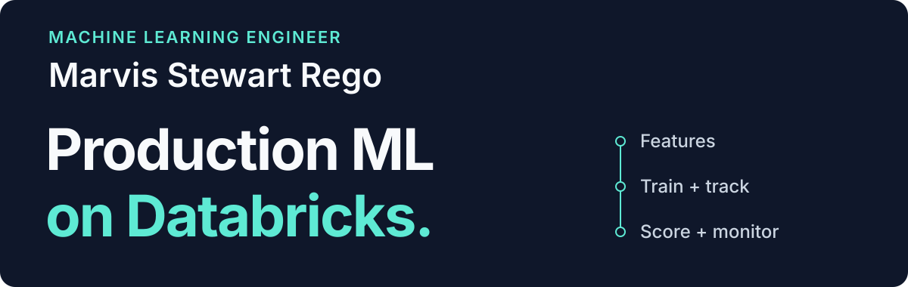

  

  
  
  

  <picture>
    <source media="(prefers-reduced-motion: reduce)" srcset="./assets/readme/typing.svg" />
    
  </picture>

## 👋 About me

I'm **Marvis Stewart Rego**, a **Machine Learning Engineer based in Dubai, UAE**. I build production ML on Databricks, from feature engineering and model training to batch scoring and monitoring. My work spans forecasting, segmentation, LLM scoring, and ML observability.

- Previously a **Machine Learning Engineer at Global Hotel Alliance**, working with marketing and finance teams.
- **MSc in Data Science and Artificial Intelligence, completed**, Middlesex University Dubai. **GPA: 4.0**.
- Open to **ML Engineer**, **AI Engineer**, and **Data Science** roles.

## 🛠️ Tech stack

### Data and Databricks

  
  
  
  
  
  

### Languages and analysis

  
  
  
  
  
  

### Machine learning and generative AI

  
  
  
  
  
  
  
  
  

### Cloud and delivery

  
  
  
  
  
  

## 🚀 Selected personal projects

### [DreamTrip](https://github.com/marvisrego/DreamTrip)

A travel-planning app that turns a prompt into destination suggestions and day-by-day itineraries, with live travel context when search is enabled.

**Built with:** NVIDIA Nemotron, Tavily, React.

### [GraphRAG Career Advisor](https://github.com/marvisrego/KnowledgeGraph_Recommendation)

A career-guidance chatbot that combines an O*NET and ESCO knowledge graph with semantic retrieval and reranking to explain role recommendations and skill gaps.

**Built with:** Python, Flask, NetworkX, Qdrant, Cohere Rerank.

### AI Code Review Bot

An automated pull-request reviewer that checks code for bugs, security issues, and performance concerns through GitHub Actions.

**Built with:** Python, GitHub Actions, GitHub Models API.

## ⚙️ Production experience

At **Global Hotel Alliance**, I worked on:

- **Predictive ML:** member activation models, behavioural segmentation, and loyalty-points redemption forecasting for liability planning.
- **LLM scoring:** property-description analysis for luxury and interest labels, supporting marketing personalisation.
- **ML observability:** reusable drift detection, data quality checks, and performance alerting across production use cases.
- **Pipelines and lifecycle:** PySpark feature engineering, Delta Lake tables, MLflow tracking, and scheduled Databricks workflows.

## 🎓 Certifications

  
  
  

---

<strong>Let's build something useful.</strong>

  

